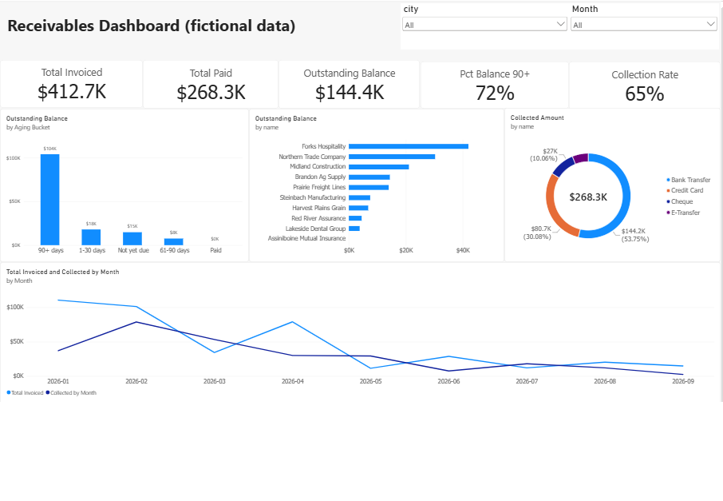

# Receivables Dashboard (Power BI)

A one-page Power BI dashboard that tracks invoicing, collections and overdue balances. It is built on the same **fictional** dataset as my SQL receivables project, and its results match the SQL queries.



## What it shows
- **KPI cards:** Total Invoiced, Total Paid, Outstanding Balance, Collection Rate, % of balance that is 90+ days past due
- **Aging analysis:** outstanding balance by aging bucket (Not yet due, 1-30, 31-60, 61-90, 90+ days)
- **Clients:** who owes the most
- **Payment methods:** share of collected cash
- **Trend:** invoiced vs collected by month
- **Slicers:** city and month

## Key findings
- Collection rate is **65%**: $268,300 collected out of $412,700 invoiced; **$144,400** is still outstanding.
- **72%** of the open balance ($104,000) is more than 90 days past due.
- Bank Transfer brings in 53.7% of collected cash; E-Transfer only 6.1%.
- Forks Hospitality alone owes $42,000 (29% of the open balance).

## Data model
Four tables (clients, invoices, payments, payment_methods) plus a Calendar table.
- `clients` 1 to many `invoices` 1 to many `payments`; `payment_methods` 1 to many `payments`
- `Calendar[Date]` to `invoices[invoice_date]` (active) and to `payments[payment_date]` (inactive, used with `USERELATIONSHIP`)

## Power Query
Loaded the 4 CSV files, set data types (IDs as text, amounts as currency, dates as date) and cleaned query names.

## DAX
Calculated columns (invoices):
```
Open Balance = invoices[invoice_total] - invoices[payment_total]
Days Past Due = DATEDIFF(invoices[due_date], DATE(2026,9,30), DAY)
Aging Bucket =
SWITCH(
    TRUE(),
    invoices[Open Balance] <= 0, "Paid",
    invoices[Days Past Due] <= 0, "Not yet due",
    invoices[Days Past Due] <= 30, "1-30 days",
    invoices[Days Past Due] <= 60, "31-60 days",
    invoices[Days Past Due] <= 90, "61-90 days",
    "90+ days"
)
```
Calculated column (payments):
```
Days to Pay = DATEDIFF(RELATED(invoices[invoice_date]), payments[payment_date], DAY)
```
Measures:
```
Total Invoiced = SUM(invoices[invoice_total])
Total Paid = SUM(invoices[payment_total])
Outstanding Balance = [Total Invoiced] - [Total Paid]
Collection Rate = DIVIDE([Total Paid], [Total Invoiced])
Balance 90+ Days = CALCULATE([Outstanding Balance], invoices[Aging Bucket] = "90+ days")
Pct Balance 90+ = DIVIDE([Balance 90+ Days], [Outstanding Balance])
Collected Amount = SUM(payments[amount])
Collected by Month = CALCULATE([Collected Amount], USERELATIONSHIP('Calendar'[Date], payments[payment_date]))
```
The "as of" date for aging is fixed at 2026-09-30 so results are reproducible.

## Files
| File | Description |
|---|---|
| `Receivables_Dashboard.pbix` | The Power BI report (open with Power BI Desktop) |
| `dashboard.png` | Screenshot |
| `clients.csv`, `invoices.csv`, `payments.csv`, `payment_methods.csv` | Source data (fictional) |

## Tools
Power BI Desktop, Power Query, DAX.
